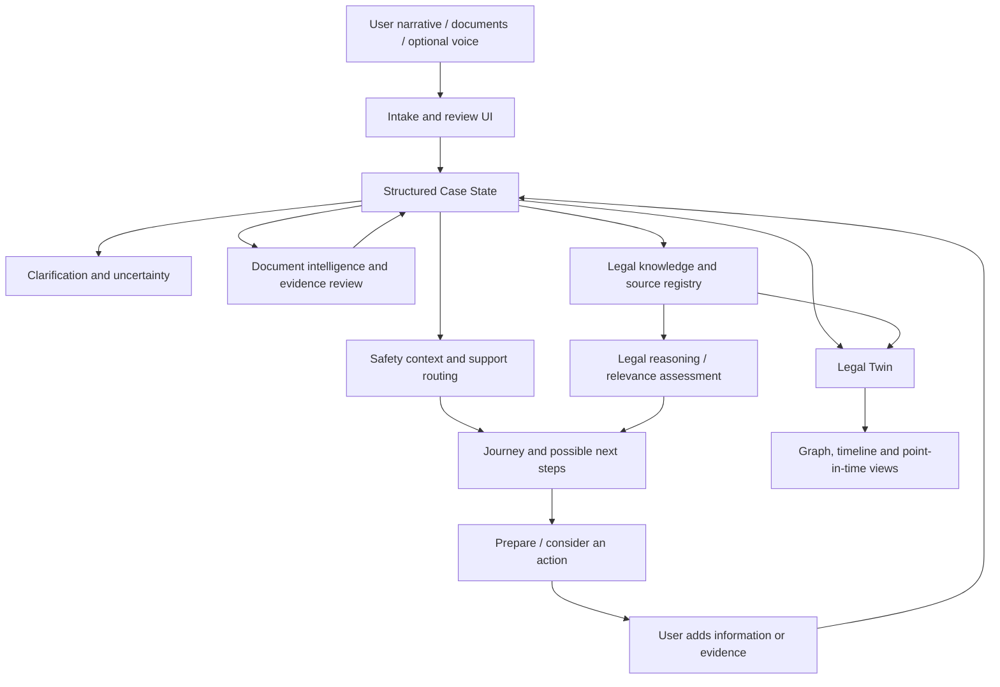
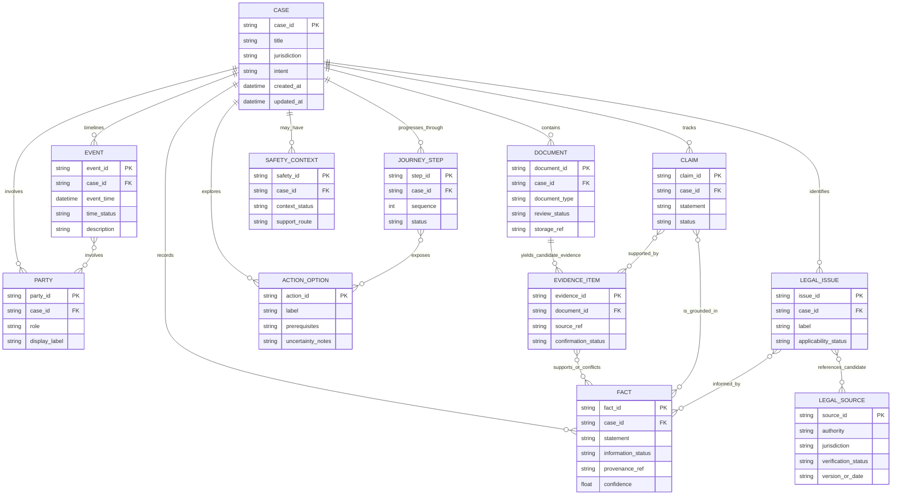

# LawSense 3.0

> **An Intelligent Legal System — Beyond Legal Chat.**  
> *Understand the situation. Know your rights. Protect yourself. Prepare your next step.*

<p align="center">
  <strong>Evidence-first legal intelligence · Interactive Legal Twin · Safety-aware navigation</strong>
</p>

LawSense 3.0 is a local-first Indian LegalTech prototype designed to help people turn a confusing legal or safety-related situation into a structured, inspectable case journey. It connects a person's account of events with facts, evidence, missing information, legal-source candidates, safety resources, possible procedural paths and practical next steps.

**The central idea is simple: law should not become useful only after a person already knows legal language.** LawSense therefore treats a legal situation as an evolving case state—not just a question sent to a chatbot.

> **Project status:** Hackathon / research prototype. Feature maturity and legal-source coverage vary by module. This repository does not claim complete coverage of Indian law or production-grade legal, security, or emergency-response readiness.

---

## At a glance

- **Domain:** LegalTech, legal information access, women's safety and social empowerment
- **Primary SDG alignment:** **UN SDG 16 — Peace, Justice and Strong Institutions**
- **Secondary SDG alignment:** SDG 5 — Gender Equality; SDG 10 — Reduced Inequalities
- **Core differentiator:** a structured, provenance-aware **Legal Twin** that can be inspected and updated as case information changes
- **Architecture:** Next.js frontend, FastAPI/Python backend, modular domain engines, local-first data design, and a Capacitor/Android development shell
- **Repository:** [viplakshay-tech/LawSense-3.0](https://github.com/viplakshay-tech/LawSense-3.0)

## Contents

- [The problem](#the-problem)
- [The solution](#the-solution)
- [How it works](#how-it-works)
- [Key capabilities](#key-capabilities)
- [What makes it different](#what-makes-it-different)
- [Comparison with existing approaches](#comparison-with-existing-approaches)
- [Architecture](#architecture)
- [Conceptual ER diagram](#conceptual-er-diagram)
- [Technology stack](#technology-stack)
- [UN Sustainable Development Goals](#un-sustainable-development-goals)
- [Quick start: local development](#quick-start-local-development)
- [Android development](#android-development)
- [Testing and quality checks](#testing-and-quality-checks)
- [Responsible use, privacy and limitations](#responsible-use-privacy-and-limitations)
- [Hackathon demo flow](#hackathon-demo-flow)
- [Roadmap](#roadmap)
- [Repository structure](#repository-structure)
- [Contributing](#contributing)
- [License](#license)
- [References](#references)

---

## The problem

People rarely begin with a legal citation or a well-formed legal question. They begin with a lived experience:

> “My landlord has not returned my deposit. I have an agreement, but I don't know what matters or what I should do next.”

That person may need more than an answer. They may need to understand which details are missing, organize records, distinguish an allegation from a supported fact, identify an official source, consider a safe course of action and prepare for a conversation with a qualified professional.

Common barriers include:

1. **Legal language and process complexity** — people may not know the right terminology or which procedural route to explore.
2. **Scattered information** — important dates, messages, agreements, receipts and claims may exist in different places.
3. **Evidence uncertainty** — a user statement, an extracted document field and a verified legal source are different types of information and should not be silently treated as equivalent.
4. **Context dependence** — jurisdiction, dates, source versions and facts can affect whether legal material is relevant.
5. **Unclear next steps** — users often need a sequence of understandable actions, not a long answer with no continuity.
6. **Safety-sensitive situations** — harassment, threats, stalking, domestic abuse, blackmail or workplace harassment can require a safety-first flow instead of ordinary legal guidance.

## The solution

LawSense organizes a legal/safety situation as a structured case that can evolve when the user clarifies facts or adds evidence. The system separates what is reported, what is supported, what is inferred, what is missing, what legal material may be relevant and what remains unestablished.

### The case journey

```text
UNDERSTAND
    ↓
CLARIFY
    ↓
PROTECT  ───────────────┐
    ↓                    │ safety-first route when needed
EVIDENCE                 │
    ↓                    │
LAW                      │
    ↓                    │
LEGAL TWIN ◄─────────────┘
    ↓
PREPARE
    ↓
ACT
    ↓
MONITOR / UPDATE
    ↺
```

**LawSense is not an AI lawyer.** It is a legal-information and navigation aid intended to make a person's situation easier to organize, inspect and discuss with appropriate support.

## How it works

1. **Tell us what happened.** The user describes the situation in ordinary language, potentially in English, Hindi or Hinglish.
2. **Structure the account.** The case-state layer organizes parties, facts, claims, events, intent, jurisdiction, assumptions, unknowns and conflicts.
3. **Clarify what is missing.** The workflow can surface gaps that could change the assessment, rather than forcing a confident conclusion from incomplete information.
4. **Review documents and evidence.** Document intelligence/review modules can extract candidate findings. Extraction should remain distinguishable from user-confirmed or evidence-supported facts.
5. **Explore legal context.** The legal-knowledge/source layer can return candidate material with source and verification metadata where available. Retrieval does not establish case-specific applicability.
6. **Inspect the Legal Twin.** The user can explore relationships and temporal information in the graph/timeline experience.
7. **Compare paths and prepare.** Journey, safety and action surfaces help the user examine possible next steps and prepare for appropriate support.
8. **Update the case.** New details can change the structured state and the Twin, preserving the distinction between earlier and newly available information where the underlying feature supports it.

## Key capabilities

> **Implementation note:** these are capabilities represented in the current codebase. Operational completeness, coverage and maturity vary; the table does not claim that every path is fully production-ready.

| Capability | What it is intended to do | Status framing |
|---|---|---|
| Natural-language intake | Let a person describe a problem without knowing legal terminology | Implemented UI; end-to-end behavior should be regression-tested |
| Structured Case State | Organize parties, facts, events, claims, evidence, intent, jurisdiction, unknowns and conflicts | Core domain capability |
| Evidence and document review | Turn selected documents into candidate findings with a review/confirmation step | Implemented modules; verify file types and flow before relying on it |
| Legal knowledge and source registry | Maintain legal-source records, provenance and governance/verification metadata | Curated prototype, not a continuously synchronized national law corpus |
| Legal Twin | Inspect connected case entities and relationships in a graph and timeline-oriented experience | Core signature interface; validate refresh and temporal behavior end-to-end |
| Legal journey and next actions | Show steps, prerequisites, gaps and possible paths rather than one isolated answer | Implemented modules; applicability remains context-dependent |
| Decision exploration | Compare possible courses of action without claiming a guaranteed legal outcome | Prototype decision-support capability |
| Women's safety pathways | Offer a distinct safety-oriented flow and relevant resource surfaces | Available in the codebase; never treat automated signals as a diagnosis or emergency service |
| Legal Guide and voice-related UI | Provide a human-facing interaction layer, with voice modules/adapters in the codebase | Provider and device availability varies; do not imply voice is fully operational everywhere |
| Document drafting surfaces | Support preparation of basic document packages from case context | Prototype; user review and jurisdiction-appropriate professional review remain important |
| Privacy-oriented utilities | Include privacy, data handling, deletion/export and safe-logging related modules | Foundation only; local storage alone is not encryption or production access control |
| Android shell | Provide a Capacitor-based path for mobile packaging and development | Development build; requires local Android SDK/JDK configuration |

## What makes it different

### 1. The case state—not the chat transcript—is the center

A conventional chat flow often starts with `Question → Answer`. LawSense is designed around `Narrative → Case State → Evidence → Unknowns → Legal Context → Journey → Twin → Next Step`. The structured case is the continuity layer across screens and actions.

### 2. Provenance is part of the information model

A user-reported statement, a document extraction, an inference and a verified source are not interchangeable. LawSense's trust model aims to preserve those differences and make uncertainty visible.

### 3. The Legal Twin is inspectable

The graph and timeline make relationships among people, events, evidence, claims, issues and legal-source candidates easier to inspect. This is a case-model visualization—not a prediction of how a court will decide.

### 4. Time and change matter

A case can change as dates are clarified, documents are added or conflicting details are discovered. The temporal direction is intended to help users understand how the recorded situation evolves, rather than treating the latest generated paragraph as the only state.

### 5. Safety is a workflow concern

Safety-sensitive context can route the experience toward a dedicated support path. LawSense must not silently contact police, family members, employers or other third parties, and must not present automated risk detection as a definitive assessment.

### 6. AI is a component, not the whole product

Structured schemas, deterministic domain logic, source metadata, evidence relationships, journey orchestration, temporal visualization and user confirmation are important independently of which AI provider—if any—is configured.

## Comparison with existing approaches

The following table compares **product emphasis**, not a claim that other products lack any particular capability. The legal-technology landscape changes continuously, and feature overlap is expected.

| Approach / example | Typical emphasis | LawSense's intended emphasis |
|---|---|---|
| General-purpose AI chatbot | Flexible conversation and broad explanations | A persistent, structured case state with visible facts, unknowns, evidence and next-step context |
| Legal chatbot / question-answer interface | Answering a legal query or routing a user to legal information | Connecting multiple steps into a case journey that can be updated as facts and documents change |
| Indian public legal-help ecosystem (for example, [NALSA](https://nalsa.gov.in/) and [NYAYA SETU / Tele-Law](https://nyayasetu.doj.gov.in/)) | Legal awareness, legal aid or access to legal information/support through public programmes | A software layer for organizing the user's narrative, evidence and unresolved questions before and alongside official support—not a replacement for those services |
| Professional legal AI (for example, [CoCounsel Legal](https://www.thomsonreuters.in/en/products/cocounsel-legal/features.html) and [Harvey](https://www.harvey.ai/platform)) | Legal research, document analysis, drafting and professional/team workflows | A citizen-first entry point centered on understanding a situation, safety pathways and an inspectable Legal Twin |
| Conventional case/document portal | Filing, records, service access or a specific administrative workflow | Helping a user organize context and prepare to choose or engage with an appropriate official/professional path |

**Positioning statement:** LawSense aims to complement authoritative public services and qualified legal professionals by helping users structure their situation, notice gaps, understand possible routes and prepare for the next conversation. It does not replace legal aid, representation, an official portal, or a lawyer's judgment.

## Architecture



### Main components

- **Next.js frontend:** intake, case workspace, guide, document review, safety and Legal Twin experiences.
- **FastAPI backend:** API routes, schemas, modular engines and service orchestration.
- **Case-state engine:** extracts and structures the record, including unknowns and conflicts.
- **Document intelligence/review:** handles document processing and human confirmation boundaries.
- **Legal knowledge/source layer:** catalogues legal-source candidates and associated metadata; source retrieval alone is not proof of applicability.
- **Legal Twin:** represents relationships and time-oriented views across case information.
- **Journey/decision/safety modules:** help organize possible paths and context-sensitive support.
- **Capacitor Android wrapper:** enables a native Android development package around the mobile experience.

## Conceptual ER diagram

The diagram below is a **conceptual domain model** to explain the relationships LawSense reasons about. It is not a guarantee that every entity maps one-to-one to a database table in the current prototype.



### Trust boundaries represented by the model

- **User-reported does not mean proven.**
- **Extracted does not mean confirmed.**
- **Retrieved legal material does not mean applicable law.**
- **A possible action is not a guaranteed outcome.**
- Conflicts and missing information should remain visible instead of being silently overwritten.

## Technology stack

| Layer | Technologies in this repository / current architecture |
|---|---|
| Web UI | Next.js, React, TypeScript |
| Styling and visuals | CSS/CSS Modules, DOM/SVG visualizations, motion and responsive interaction patterns |
| Backend/API | Python, FastAPI, Pydantic-style schemas, Uvicorn |
| Data/domain | Local database layer, structured case models, modular domain engines and service layer |
| Legal-source layer | Curated legal-knowledge records, source registry/governance and relevance/applicability status handling |
| Mobile | Capacitor, Android Gradle project, Java/Kotlin-compatible Android toolchain (current native plugin includes Java source) |
| Testing | Node.js test runner, Python test suites, Playwright browser E2E |
| Optional future integrations | Local LLMs, OCR, speech-to-text, vector search and graph databases behind provider/domain boundaries where justified |

Optional/future technologies are not required to claim that the current prototype already runs them. Provider availability depends on local setup and implementation maturity.

## UN Sustainable Development Goals

LawSense aligns most directly with **SDG 16**, with additional relevance to **SDG 5** and **SDG 10**. This is a project alignment statement, not a claim of UN partnership, endorsement, certification or measured social impact.

### Primary: SDG 16 — Peace, Justice and Strong Institutions

LawSense supports the *direction* of SDG 16 by trying to make legal information and procedural options easier to understand, organize and navigate. The strongest conceptual connection is SDG Target 16.3, which concerns the rule of law and equal access to justice. LawSense cannot itself guarantee access to representation or a fair outcome.

- Structured understanding before a legal consultation
- Evidence organization and visible information gaps
- Source-aware legal-information navigation
- Possible next-step preparation and official-resource discovery

Official UN goal: https://sdgs.un.org/goals/goal16

### Secondary: SDG 5 — Gender Equality

The women's safety and empowerment direction connects to SDG 5's focus on ending violence against women and girls and using enabling technology to support women's empowerment. Safety pathways must be conservative, privacy-aware and clear that they are not an emergency service.

Official UN goal: https://sdgs.un.org/goals/goal5

### Secondary: SDG 10 — Reduced Inequalities

Plain-language intake and a structured navigation approach may reduce some information barriers for people who are unfamiliar with legal processes. Whether this improves outcomes requires user research and measured evaluation; the README does not claim impact without evidence.

Official UN goal: https://sdgs.un.org/goals/goal10

## Quick start: local development

The project is designed for local development. Commands below assume Windows CMD and the repository root at `C:\LawSense\LawSense-3.0`. Keep the frontend and backend in separate terminal windows.

### Prerequisites

- Node.js and npm
- Python compatible with the backend requirements
- Git
- Android Studio, Android SDK and a compatible JDK only if building the Android app

### 1. Install frontend dependencies

```cmd
cd /d C:\LawSense\LawSense-3.0
npm ci
```

### 2. Prepare the backend environment (first setup only)

```cmd
cd /d C:\LawSense\LawSense-3.0\api
py -m venv .venv
.venv\Scripts\activate.bat
python -m pip install --upgrade pip
python -m pip install -r requirements.txt
```

If Windows does not recognize `py`, install Python and rerun with the installed interpreter. Keep local virtual environments out of version control.

### 3. Start the backend

In a dedicated CMD window:

```cmd
cd /d C:\LawSense\LawSense-3.0\api
set "PYTHONPATH=C:\LawSense\LawSense-3.0\api"
.venv\Scripts\python.exe -m uvicorn app.main:app --reload --host 127.0.0.1 --port 8000
```

Backend docs should be available at http://127.0.0.1:8000/docs.

### 4. Start the frontend

In a second CMD window:

```cmd
cd /d C:\LawSense\LawSense-3.0
set "NEXT_PUBLIC_API_URL=http://127.0.0.1:8000"
npm run dev -- --hostname 127.0.0.1
```

The frontend should be available at http://localhost:3000. `next.config.ts` uses `NEXT_PUBLIC_API_URL` as the API rewrite origin. Restart the frontend after changing environment variables.

### 5. Optional phone testing over a local hotspot

The default commands above bind to loopback and are intentionally not reachable from a phone. For a temporary phone test:

1. Use a private, isolated phone hotspot—not shared/public Wi-Fi.
2. Keep the API bound to `127.0.0.1:8000`; the Next.js server calls it through the same computer.
3. Stop the frontend and restart it with `npm run dev -- --hostname 0.0.0.0`.
4. Run `ipconfig`, identify the PC's hotspot IPv4 address, and open `http://<PC-IPv4>:3000` on the phone.
5. If necessary, allow inbound port 3000 only on the appropriate **Private** Windows network profile. Close the network-accessible frontend when the test is over.

**Critical privacy limitation:** this prototype currently has no user sign-in or case-ownership authorization. A person who can reach the network-exposed Next.js app may be able to read or change case data through its same-origin API proxy. CORS, an unguessable case ID, a trusted Wi-Fi name, and binding the Python API to loopback do not solve that frontend exposure.

Until application access control is implemented and tested, use **synthetic/fictional case data only** for phone-over-network tests. Do not use real legal narratives, identity details, evidence, or documents; do not expose this development server on a shared network or the public internet.

## Android development

The repository contains a Capacitor Android project. Android builds depend on the locally installed Android SDK, JDK/Gradle compatibility and a valid Capacitor configuration.

- The default Capacitor configuration is intended to use the bundled `capacitor-shell` unless a remote development server is explicitly configured.
- For local remote-URL development, configure the local-only environment variable `CAPACITOR_SERVER_URL` to the current reachable frontend URL before syncing/building, if supported by the checked-in `capacitor.config.ts`.
- Run `npx cap sync android` from the **repository root**, not from inside the `android` directory.
- Build from `android` with `gradlew.bat assembleDebug` after setting a valid `JAVA_HOME` and Android SDK path.
- The development app's remote URL and cleartext networking settings are not production settings. A production release should use HTTPS and a reviewed network-security configuration.

Typical commands (after the SDK/JDK are configured):

```cmd
cd /d C:\LawSense\LawSense-3.0
npx cap sync android
cd android
gradlew.bat assembleDebug
```

The expected debug APK output, when the build succeeds, is `android\app\build\outputs\apk\debug\app-debug.apk`.

## Testing and quality checks

Run checks relevant to the files you change. Test scripts available at the root include:

```cmd
cd /d C:\LawSense\LawSense-3.0
npm run test:api
npm run test:resources
npm run test:guide
npm run test:session-restoration
npm run lint
```

For frontend production compilation:

```cmd
npm run build
```

Backend tests live under `api\tests`. From a prepared backend environment:

```cmd
cd /d C:\LawSense\LawSense-3.0\api
.venv\Scripts\python.exe -m pytest -q
```

The Playwright browser suite is under `tests\browser-e2e`. It launches a production-mode frontend plus an isolated API/database/document workspace; check `tests\browser-e2e\README.md` for runner-specific requirements and environment variables before running it. The project has had browser-regression failures during development, so **do not report the browser suite as passing unless you rerun it and see the passing summary**.

## Responsible use, privacy and limitations

LawSense can handle sensitive personal and safety-related information. Use synthetic data for demos, testing and screenshots.

- **Not legal advice:** LawSense is not a lawyer, law firm, court, legal representative or emergency-response service.
- **No guaranteed results:** the platform cannot promise that a claim is valid, a law applies, a complaint will be accepted or a user will win.
- **Verify legal material:** check the current official source, jurisdiction, effective date and applicability with an appropriate professional or authority.
- **Treat sources conservatively:** legal knowledge in the prototype is curated and incomplete; it is not a complete, continuously updated repository of every Indian statute, rule, judgment or local procedure.
- **Safety first:** in immediate danger, contact appropriate local emergency services or trusted support. Do not rely on this application as the sole source of help.
- **Local-first is not automatically secure:** production use needs a dedicated review of authentication, authorization, encryption, storage, backups, retention, deletion, dependency security and incident response.
- **Protect secrets:** never commit `.env` files, credentials, private keys, live databases, real case documents or personal identifying information.
- **Review extracted facts:** automated extraction may be incomplete or wrong. A candidate finding should not silently become a confirmed fact.

## Hackathon demo flow

Use a fictional/synthetic case such as a withheld rental deposit. Do not use real names, addresses, phone numbers, case records or documents.

1. **Intake:** enter the user's narrative in plain language.
2. **Structure:** show the Case State—facts, parties, intent and known/unknown information.
3. **Evidence:** provide a synthetic agreement or sample record, then show findings and the review/confirmation boundary.
4. **Legal Twin:** inspect the relationship graph and timeline; explain which nodes come from the case and which are legal-source candidates.
5. **Legal context:** show source/provenance and clearly state when applicability is not established.
6. **Safety path:** demonstrate a fictional safety-sensitive flow without real personal data or claims of automatic emergency response.
7. **Next step:** show possible paths, missing prerequisites and what a user may need to verify.
8. **Update:** add a new fact or piece of evidence and demonstrate how the case representation changes.

### 30-second pitch

> **LawSense is an intelligent legal system designed to help people who know what happened but may not know the legal language or the next step. Instead of treating the problem as one chatbot question, LawSense builds a structured, evidence-aware Legal Twin that connects facts, documents, uncertainty, legal-source candidates, safety resources and a guided case journey. The goal is to make legal situations easier to understand, inspect and prepare for—without pretending to replace lawyers or official legal services.**

## Roadmap

The following items are forward-looking goals, not a claim that all are already complete:

- [ ] Strengthen end-to-end reliability across intake → evidence review → Legal Twin → journey → next action
- [ ] Resolve all outstanding browser E2E regressions and keep a repeatable release test process
- [ ] Improve frontend/backend schema contracts and API error handling
- [ ] Expand source verification, legal version/freshness tracking and jurisdiction-aware applicability checks
- [ ] Improve document ingestion, extraction provenance and human confirmation flows
- [ ] Expand accessible multilingual support and verify each language path with real evaluation
- [ ] Harden local data isolation, deletion/export, authentication and production security
- [ ] Build a clearer event/audit model for case-state changes and point-in-time reconstruction
- [ ] Evaluate the Legal Twin with usability tests, accessibility checks and measurable task-completion outcomes
- [ ] Package and test the Android application across real devices; use HTTPS for production
- [ ] Add documented, reproducible benchmarks for extraction, retrieval relevance, unsupported claims and latency

## Repository structure

```text
LawSense-3.0/
├── app/                         # Next.js routes and page-level UI
├── components/                  # Case workspace, guide, twin, safety, documents, voice UI
├── hooks/                       # React hooks
├── lib/                         # API client, case context and journey utilities
├── public/                      # Static web assets
├── api/
│   ├── app/
│   │   ├── engines/              # Case state, legal knowledge, twin, safety, documents, etc.
│   │   ├── routes/               # FastAPI routes
│   │   ├── schemas/              # API/domain schemas
│   │   └── services/             # Application services
│   ├── tests/                    # Python backend tests
│   └── requirements.txt
├── android/                      # Android/Gradle project
├── capacitor-shell/              # Bundled mobile-shell entry point
├── tests/
│   ├── api/                      # Node/API tests
│   ├── browser-e2e/               # Playwright browser regression suite
│   ├── guide/
│   ├── resources/
│   └── session-case-restoration.test.mjs
├── capacitor.config.ts
├── next.config.ts
├── package.json
└── README.md
```

## Contributing

Contributions and issue reports are welcome once the repository's licensing and intellectual-property status has been decided. For meaningful changes:

1. Open an issue or describe the user problem and intended behavior.
2. Keep legal facts, legal-source records and user-reported statements distinguishable.
3. Add or update tests for domain logic and user-visible flows.
4. Run the relevant checks and report failures honestly.
5. Never include real personal data or confidential legal documents in test fixtures.

## License

**No license is declared by this README alone.** Add a root `LICENSE` file only after deciding whether the project is ready for open-source reuse and reviewing third-party assets/dependencies.

If the intention is to invite community contributions and permit broad reuse, **Apache License 2.0** is a strong candidate because it is permissive and includes an express contributor patent license. If keeping the project proprietary or assessing patent options is still important, keep the repository private and obtain appropriate IP advice before publishing the source or granting a license. A license is not a patent filing and does not itself preserve novelty.

License reference: https://www.apache.org/licenses/LICENSE-2.0

## References

- United Nations SDG 16 — Peace, Justice and Strong Institutions: https://sdgs.un.org/goals/goal16
- United Nations SDG 5 — Gender Equality: https://sdgs.un.org/goals/goal5
- United Nations SDG 10 — Reduced Inequalities: https://sdgs.un.org/goals/goal10
- National Legal Services Authority (NALSA): https://nalsa.gov.in/
- NYAYA SETU / Tele-Law portal: https://nyayasetu.doj.gov.in/
- Thomson Reuters CoCounsel Legal features: https://www.thomsonreuters.in/en/products/cocounsel-legal/features.html
- Harvey legal AI platform: https://www.harvey.ai/platform
- Apache License 2.0: https://www.apache.org/licenses/LICENSE-2.0

---

<p align="center">
  <strong>LawSense 3.0</strong><br />
  Understand the situation. Know your rights. Protect yourself. Prepare your next step.
</p>
